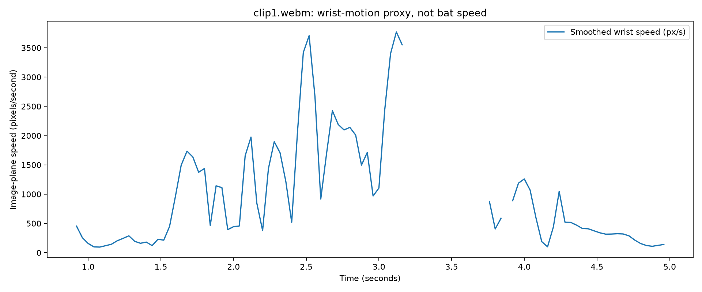
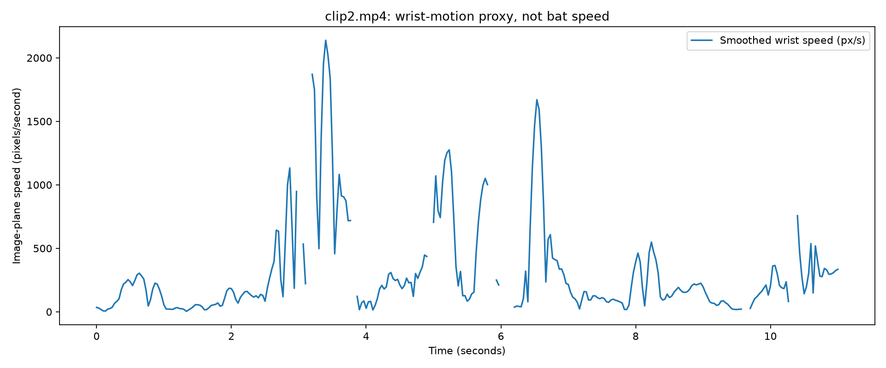
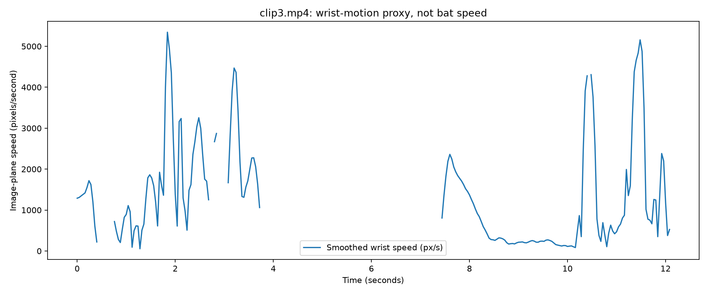

# Cricket Bat-Speed Estimation — Str8bat AI Engineer Take-Home

## Overview
This project implements a baseline using an off-the-shelf YOLOv8 pose model to track wrist motion in cricket footage and plot image-plane velocity.

**Important:** the current prototype measures wrist velocity in pixels per second. It is not a calibrated bat-speed estimate in m/s or km/h.

## Contents
- `cricket_wrist_motion.py` — prototype implementation
- `design_approach.md` — proposed end-to-end system
- `failure_analysis.md` — experimental results and limitations
- `results/` — generated plots, tracking CSVs, annotated videos, and summaries
- `requirements.txt` — Python dependencies

## Setup
Use the Python environment in which the prototype was tested, or create a new environment with a compatible Python version.

```bash
python -m venv .venv
source .venv/bin/activate
python -m pip install --upgrade pip
pip install -r requirements.txt
```

Run `python cricket_wrist_motion.py --help` to inspect the script's supported arguments, then run it on a clip using the appropriate options.

## Limitations
The current baseline does not fully compensate for camera motion, directly track bat orientation, recover full 3D motion, or validate against paired sensor ground truth. Pixel velocities cannot be compared directly across different camera views.

## Reproducibility and privacy
Keep the original clip filenames and record the commands used for each run. Do not publish source videos unless redistribution is permitted. The supplied model weights may also be excluded from version control if they can be downloaded separately.
## Results

### Clip 1



### Clip 2



### Clip 3



